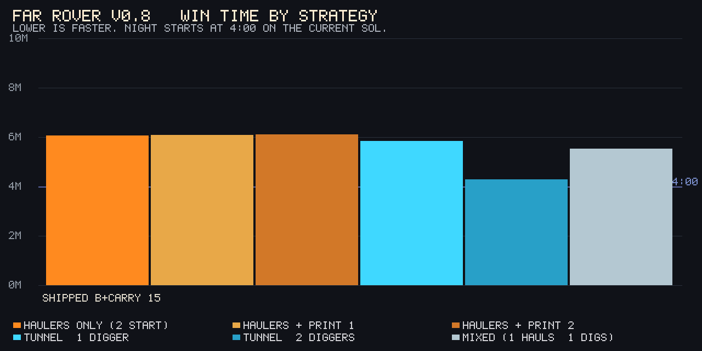

# Far Rover v0.8 balance report

Headless harness under `v08/balance/`. It imports the real `createGame()` sim and the real scout engine (`v08/engine.js` → `simulation.js`). Strategies issue only player orders: place, print, Dig, right-click via `issueContextual`, launch scout, land crew. No `assignOrder` dest shortcuts, `setResources`, teleports, or forced completes.

## Stop report (2026-10-12, r5 low-effort tunnel on #53): persist dig / auto-reroute, criterion 2 still short

#53 is on `main` (`c965e51`). Game Designer chose (b): make the finished tunnel the low-effort route. No number changes. Off-road and `haulerCarry` locked. Root demo still 5/46/45. Tests green, including the three new persist / reroute / digger-haul cases. Merge either way — this is the ship of that behavior, not a 5/5.

Diggers stay on Dig until the last tile, resume after a power cut, and go back to the best Deep Ice haul when the corridor opens. Haulers whose drop is faster through the tube switch on the same tick. One toast: "Tunnel open, haulers rerouted" if anyone switched, else #51's "Tunnel complete".

Persist-dig helps long delays (delay 10 2-digger 5:45 → **5:36**) but does not put any delay into 20–35%. Stop; no further knob changes.

### 1x best-placement table (dt = 1/60, delay 0)

| Strategy | Best layout | Win | Night | Power min | Ice |
|---|---|---:|:---:|---:|---:|
| Haulers only (2 start) | nearest-ice | 7:26 | yes | 48 | 180 |
| Haulers + print 1 | nearest-ice | 6:36 | yes | 0 | 180 |
| Haulers + print 2 | nearest-ice | 5:51 | yes | 0 | 180 |
| Haulers + print 3 | nearest-ice | 5:51 | yes | 0 | 180 |
| Haulers + print 4 | nearest-ice | 5:51 | yes | 0 | 180 |
| Tunnel, 1 digger | corr-10 | 6:14 | yes | 27 | 180 |
| Tunnel, 2 diggers | corr-10 | 4:47 | yes | 18 | 180 |
| Tunnel, 3 diggers | corr-10 | 5:06 | yes | 0 | 180 |
| Tunnel, 4 diggers | corr-10 | 5:05 | yes | 0 | 180 |
| Tunnel + surface haulers | corr-10 | 5:16 | yes | 0 | 180 |
| Mixed (1 hauls, 1 digs) | corr-10 | 6:54 | yes | 39 | 180 |

Best haulers-only: **Haulers + print 2** at 5:51 (print-3/4 tie). Best tunnel: **Tunnel, 2 diggers** at 4:47 (**18.4% faster**).

### Tunnel lead across reaction delays 0–10 s

Pinned delay-0 layouts: 2-digger `corr-10` vs best haulers at that delay (print-2 or print-3 `nearest-ice`).

| Delay | 2-digger | Best haulers | Lead | GD |
|---|---:|---|---:|---:|
| 0 s | 4:47 | 5:51 print-2 nearest-ice | 18.4% | 4/5 |
| 1 s | 4:51 | 5:54 print-2 nearest-ice | 17.8% | 4/5 |
| 2 s | 4:56 | 5:23 print-2 nearest-ice | 8.6% | 4/5 |
| 3 s | 5:01 | 5:28 print-3 nearest-ice | 8.4% | 4/5 |
| 4 s | 5:06 | 5:31 print-3 nearest-ice | 7.7% | 4/5 |
| 5 s | 5:11 | 5:29 print-3 nearest-ice | 5.5% | 4/5 |
| 6 s | 5:16 | 5:32 print-3 nearest-ice | 4.8% | 4/5 |
| 7 s | 5:21 | 5:46 print-2 nearest-ice | 7.3% | 4/5 |
| 8 s | 5:26 | 5:48 print-2 nearest-ice | 6.4% | 4/5 |
| 9 s | 5:31 | 5:50 print-2 nearest-ice | 5.5% | 4/5 |
| 10 s | 5:36 | 5:52 print-2 nearest-ice | 4.7% | 4/5 |

Earliest win at delay 0 is 4:47 (17 s inside the no-win-under-4:00 / 30 s margin rule).

### Five criteria (every delay 0–10)

| # | Criterion | Result |
|---|---|---|
| 1 | Haulers + print 1 beats haulers only | **Pass** at every delay. Delay 0: 6:36 vs 7:26. |
| 2 | Tunnel with 2 diggers is 20–35% faster than the best haulers-only route including prints | **FAIL** at every delay. Peak 18.4% at delay 0 vs print-2 5:51. Floor 4.7% at delay 10. |
| 3 | Every winning route crosses at least one night | **Pass.** First night is at 1:30. |
| 4 | Power drops below 50 on at least one tunnel route | **Pass.** 2-digger `powerMin` 18. |
| 5 | No route wins under 4:00 (30 s margin) | **Pass.** Earliest legal win is 4:47. |

### Why stop

Persist-dig and auto-reroute cannot put every delay in 20–35% without a number change. Off-road, range, ice, and carry were left alone.

## Stop report (2026-10-12, r5-tune on #52): print 30/60/90, delay hold, criterion 2 still short

#52 is on `main` (`eb69a09`). No Pages/CI deploy job; merge to main is the ship path. This tune sits on top of that. Off-road and `haulerCarry` were not touched. Root demo still 5/46/45. Tests green. **Not merging** — all five criteria do not pass at every delay 0–10.

**Step 2:** print 30 s / 60 s / 90 s (then 90 s each after). Dig kept at **15 s/tile**.

**Delay artifacts (same routes, not new layouts):**

| Delay | Old lead (thinkEvery = delay) | Route vs layout | What it was |
|---|---:|---|---|
| 5 s | 1.6% | print-3 `nearest-ice` 5:06 vs 2-digger `corr-10` 5:01 | Harness APM artifact. `thinkEvery = delay` starved re-clicks; same 5-hauler printer+2-storage line ran *faster*. Control: delay 10 with thinkEvery 0.5 matched delay 0 (5:43 vs 4:46). |
| 7 s | 2.3% | print-3 `nearest-ice` 5:08 vs `corr-10` 5:01 | Same artifact, same layouts. |
| 8 s | 2.5% | print-3 `nearest-ice` 5:20 vs `corr-10` 5:12 | Same artifact, same layouts. |
| 10 s | 0.0% | print-3 `nearest-ice` 5:10 vs `corr-10` 5:10 | Same artifact, same layouts. |

Fix: think every 0.5 s; apply delay only after a situation change (scout confirm, building done, print done). Second-pad `keepBuilding` now sees the whole roster so each think does not yank another ice hauler onto the pad (that had been hiding ~10 s of print-2). Neither fix loosens a layout search.

After those fixes the old 0% / 1.6–2.5% rows are gone, but criterion 2 still fails at every delay. Print-2/3 `nearest-ice` is the haulers winner throughout. At delay 2–7 it even beats delay-0 print-2 (5:24–5:35 vs 5:51) because a 2 s hold after the second storage completes lets auto-resume walk while delay 0 re-clicks immediately — same layout, not a new route. Not hidden.

**Step 3 (not applied):** print-3/2 is still inside 20% at delay 0 (18.4%). A dig cut toward 4:34 (band 4:30–4:55, 30 s margin under 4:00) would put delay 0 at ~22% vs print-2 5:51. Delay 2 print-2 is **5:24**; 20% there needs a 2-digger at **4:19**, which is under 4:30. Tunnel already slows ~6 s per delay-second (4:46 → 4:57 at 2 s) while print gets faster, so the band cannot cover delays 2–10. Dig stays 15.

### 1x best-placement table (dt = 1/60, delay 0)

| Strategy | Best layout | Win | Night | Power min | Ice |
|---|---|---:|:---:|---:|---:|
| Haulers only (2 start) | nearest-ice | 7:26 | yes | 48 | 180 |
| Haulers + print 1 | nearest-ice | 6:35 | yes | 0 | 180 |
| Haulers + print 2 | nearest-ice | 5:51 | yes | 0 | 180 |
| Haulers + print 3 | nearest-ice | 5:51 | yes | 0 | 180 |
| Haulers + print 4 | nearest-ice | 5:51 | yes | 0 | 180 |
| Tunnel, 1 digger | corr-10 | 6:14 | yes | 27 | 180 |
| Tunnel, 2 diggers | corr-10 | 4:46 | yes | 18 | 180 |
| Tunnel, 3 diggers | corr-10 | 5:07 | yes | 0 | 180 |
| Tunnel, 4 diggers | corr-10 | 5:06 | yes | 0 | 180 |
| Tunnel + surface haulers | corr-10 | 5:16 | yes | 0 | 180 |
| Mixed (1 hauls, 1 digs) | corr-10 | 6:53 | yes | 39 | 180 |

Best haulers-only: **Haulers + print 2** at 5:51 (print-3/4 tie). Best tunnel: **Tunnel, 2 diggers** at 4:46 (**18.4% faster**).

### Tunnel lead across reaction delays 0–10 s

Pinned delay-0 layouts: 2-digger `corr-10` vs best haulers at that delay (print-2 or print-3 `nearest-ice`).

| Delay | 2-digger | Best haulers | Lead | GD |
|---|---:|---|---:|---:|
| 0 s | 4:46 | 5:51 print-2 nearest-ice | 18.4% | 4/5 |
| 1 s | 4:51 | 5:53 print-2 nearest-ice | 17.5% | 4/5 |
| 2 s | 4:57 | 5:24 print-2 nearest-ice | 8.0% | 4/5 |
| 3 s | 5:03 | 5:28 print-3 nearest-ice | 7.5% | 4/5 |
| 4 s | 5:09 | 5:31 print-3 nearest-ice | 6.6% | 4/5 |
| 5 s | 5:15 | 5:29 print-3 nearest-ice | 4.0% | 4/5 |
| 6 s | 5:21 | 5:32 print-3 nearest-ice | 3.1% | 4/5 |
| 7 s | 5:27 | 5:35 print-3 nearest-ice | 2.1% | 4/5 |
| 8 s | 5:33 | 5:47 print-2 nearest-ice | 4.0% | 4/5 |
| 9 s | 5:39 | 5:50 print-2 nearest-ice | 3.0% | 4/5 |
| 10 s | 5:45 | 5:52 print-2 nearest-ice | 2.0% | 4/5 |

Earliest win at delay 0 is 4:46 (30 s inside the no-win-under-4:00 rule). At delay 9–10 the earliest is tunnel-3 `corr-10` at 5:38 / 5:40.

### Five criteria (every delay 0–10)

| # | Criterion | Result |
|---|---|---|
| 1 | Haulers + print 1 beats haulers only | **Pass** at every delay. Delay 0: 6:35 vs 7:26. |
| 2 | Tunnel with 2 diggers is 20–35% faster than the best haulers-only route including prints | **FAIL** at every delay. Peak 18.4% at delay 0 vs print-2 5:51. Floor 2.0% at delay 10. |
| 3 | Every winning route crosses at least one night | **Pass.** First night is at 1:30. |
| 4 | Power drops below 50 on at least one tunnel route | **Pass.** 2-digger `powerMin` 18. |
| 5 | No route wins under 4:00 (30 s margin) | **Pass.** Earliest legal win is 4:46. |

### Why stop

Steps 2 and 3 together cannot put every delay in 20–35% without a win under 4:30. Off-road, range, ice, and carry were left alone.

## Shipped set (2026-10-12, r5): tunnel delivery + resume-after-build, then print 30/45/60

Harness numbers below were taken **after** both Player 1 bugfixes and the resume-after-build fix, with tests. Root demo still 5/46/45. No renderer / tutorial / UI files touched.

**Bugfixes (before any rebalance):**
- Haulers score drop-offs by walk time (off-road 0.5×). A finished tunnel is used whenever that walk is strictly faster; existing haul dests retarget. Out-of-range hubs are not auto-picks until the tunnel is ready.
- Ice sent through the tunnel reaches storage. The in-range home hub overflows into habitat/storage without a vault; the far hub sends all ice, not only `outboundIce`. 20+20 hub buffers no longer sit in transit forever.
- After any build, a hauler that was hauling resumes the loop (cargo → toDest, else remaining ice). Idle-with-cargo help is unchanged when the unit has no haul history.

**Rebalance (item 1):** print time 30s / 45s / 60s, no hard cap. Dig stays **15 s/tile** because the 2-digger corr-10 is already **4:46** (band 4:45–4:55). Raising dig to 16–20 moved the 2-digger to 4:51–5:12 and shrank the lead. Fresh search: print-3, print-4, 3/4 diggers, tunnel + surface haulers; delays every second 0–10.

### 1x best-placement table (dt = 1/60, delay 0)

| Strategy | Best layout | Win | Night | Power min | Ice |
|---|---|---:|:---:|---:|---:|
| Haulers only (2 start) | nearest-ice | 7:26 | yes | 11.9 | 180 |
| Haulers + print 1 | nearest-ice | 7:17 | yes | 12 | 180 |
| Haulers + print 2 | nearest-ice | 5:55 | yes | 0 | 180 |
| Haulers + print 3 | nearest-ice | 5:43 | yes | 0 | 180 |
| Haulers + print 4 | nearest-ice | 5:43 | yes | 0 | 180 |
| Tunnel, 1 digger | corr-10 | 6:14 | yes | 27 | 180 |
| Tunnel, 2 diggers | corr-10 | 4:46 | yes | 18 | 180 |
| Tunnel, 3 diggers | corr-10 | 5:07 | yes | 0 | 180 |
| Tunnel, 4 diggers | corr-10 | 5:08 | yes | 0 | 180 |
| Tunnel + surface haulers | corr-10 | 5:16 | yes | 0 | 180 |
| Mixed (1 hauls, 1 digs) | corr-10 | 6:53 | yes | 39 | 180 |

Best haulers-only: **Haulers + print 3** at 5:43 (print-4 ties). Best tunnel: **Tunnel, 2 diggers** at 4:46 (**16.4% faster**). 3/4 diggers are slower than 2 because they print first.

### Five criteria (worst case = fastest legal win)

| # | Criterion | Result |
|---|---|---|
| 1 | Haulers + print 1 beats haulers only | **Pass.** 7:17 vs 7:26. |
| 2 | Tunnel with 2 diggers is 20–35% faster than the best haulers-only route including prints | **FAIL.** 16.4% vs print-3 5:43. vs print-2 5:55 is 19.4%, still short of 20%. |
| 3 | Every winning route crosses at least one night | **Pass.** First night is at 1:30. |
| 4 | Power drops below 50 on at least one tunnel route | **Pass.** 2-digger `powerMin` 18. |
| 5 | No route wins under 4:00 | **Pass.** Earliest legal win is 4:46. |

### Dig sweep (2-digger corr-10, delay 0)

| Dig s/tile | 2-digger | vs print-3 5:43 |
|---|---:|---:|
| **15** | **4:46** | 16.4% (in 4:45–4:55 band) |
| 16 | 4:51 | 15.2% |
| 17 | 4:57 | 14.0% |
| 18 | 5:01 | 12.8% |
| 19 | 5:06 | 11.4% |
| 20 | 5:12 | 9.6% |

A 20% lead vs print-3 5:43 would need the 2-digger at **4:34**, which is outside the 4:45–4:55 band. Escalation plus dig cannot get there, so no other knobs were changed.

### Tunnel lead across reaction delays 0–10 s

Best 2-digger layout `corr-10` vs print-3 `nearest-ice` (best haulers-only at delay 0):

| Delay | 2-digger | Print-3 | Lead |
|---|---:|---:|---:|
| 0 s | 4:46 | 5:43 | 16.4% |
| 1 s | 4:50 | 5:45 | 15.9% |
| 2 s | 4:52 | 5:46 | 15.7% |
| 3 s | 4:55 | 5:52 | 16.2% |
| 4 s | 4:57 | 5:17 | 6.3% |
| 5 s | 5:01 | 5:06 | 1.6% |
| 6 s | 5:06 | 5:48 | 12.1% |
| 7 s | 5:01 | 5:08 | 2.3% |
| 8 s | 5:12 | 5:20 | 2.5% |
| 9 s | 5:06 | 6:00 | 15.0% |
| 10 s | 5:10 | 5:10 | 0.0% |

Lead never reaches 20%. Print-3 times at delay ≥ 4 jump around because the brain thinks once per delay window; none of those rows recover the band.

### Stop report (Game Designer)

Print escalate 30/45/60 did slow print-4 from Player 2's 4:49 to 5:43, but print-3 still wins haulers-only at 5:43. Walk-time drop scoring (required for "use the finished tunnel when faster") also trimmed print-2 from 6:07 to 5:55. With the 2-digger pinned at 4:46, the lead is 16.4% vs the new best print route. Changing off-road, range, ice, or carry was out of scope once escalation plus dig could not open 20–35%.

## Shipped set (2026-10-12, r4 + P1 10–14): orthogonal tunnels, dig 15 s, Scout program, UX/resume

Player 1's round 4 report (items 10–14) is on this set. None of those items change numbers, so the harness tables below are the same as the r4 ship. Criteria use the **fastest legal win**. Root demo still 5/46/45.

Player 2's 3:34 win used a 7-tile diagonal-touch line (`far (34,8)`, `home (25,11)`, y=10 x=27..33) that only corner-touched the hubs. Round 4 makes that line illegal and ports P2's full layout search (including diagonal attempts, vault drops, and reaction delays `[0, 2, 3, 4, 6, 10]`).

Shipped knobs: `commandRangeRadius` 10, `haulerOffRoadSpeedMult` 0.5, `deepIceTilesFromStartStorage` 21, `digSecondsPerTilePerRover` **15**. Vault command range uses the full 3×3 footprint; storage/hubs still use the building center.

### 1x best-placement table (dt = 1/60, delay 0)

| Strategy | Best layout | Win | Night | Power min | Ice |
|---|---|---:|:---:|---:|---:|
| Haulers only (2 start) | nearest-ice | 7:26 | yes | 0 | 180 |
| Haulers + print 1 | nearest-ice | 6:53 | yes | 0 | 188.8 |
| Haulers + print 2 | nearest-ice | 6:07 | yes | 0 | 198.9 |
| Tunnel, 1 digger | corr-10 | 6:14 | yes | 27 | 180 |
| Tunnel, 2 diggers | corr-10 | 4:46 | yes | 18 | 180 |
| Mixed (1 hauls, 1 digs) | corr-10 | 6:42 | yes | 39 | 180 |

Best haulers-only: **Haulers + print 2** at 6:07.
Best tunnel: **Tunnel, 2 diggers** at 4:46 (**22.1% faster**).

### Five criteria (worst case = fastest legal win)

| # | Criterion | Result |
|---|---|---|
| 1 | Haulers + print 1 beats haulers only | **Pass.** 6:53 vs 7:26. |
| 2 | Tunnel with 2 diggers is 20–35% faster than the best haulers-only route including prints | **Pass.** 22.1% (4:46 vs print-2 6:07). |
| 3 | Every winning route crosses at least one night | **Pass.** First night is at 1:30. |
| 4 | Power drops below 50 on at least one tunnel route | **Pass.** 2-digger `powerMin` 18. |
| 5 | No route wins under 4:00 | **Pass.** Earliest legal win is 4:46. P2's 3:34 diagonal is rejected. |

### Tunnel lead across reaction delays

Best 2-digger layout `corr-10` vs print-2 `nearest-ice`:

| Delay | 2-digger | Print-2 | Lead |
|---|---:|---:|---:|
| 0 s | 4:46 | 6:07 | 22.1% |
| 2 s | 4:52 | 6:15 | 22.0% |
| 3 s | 4:55 | 6:20 | 22.2% |
| 4 s | 4:57 | 6:13 | 20.4% |
| 6 s | 5:06 | 6:31 | 21.5% |
| 10 s | 5:10 | 6:29 | 20.5% |

Lead holds **20.4–22.2%** across the sweep.

### Drop distance (including vault)

Nearest legal in-range drop is **10.77 tiles** from Deep Ice: storage at `(25,11)` (chebyshev 10). The harness also searches vaults beside ring-edge hubs (all 3×3 tiles must sit in command range). No vault is closer than that storage. Floor: ≥10.

### Honest Playwright (1x, `canPlace` only)

| Route | Time | Notes |
|---|---:|---|
| Haulers (storage next to habitat) | **11:57** | Naive floor without the tip. |
| Naive starter following the tip | **7:30** | First storage at ring-edge `(25,11)`. |
| 1-digger (longer legal corridor) | **6:41** | |
| 2-digger (longer legal corridor) | **4:56** | |
| Ring-edge 2-digger | **4:32** | home `(22,9)` / far `(34,8)`, corr-10. |

No honest win under 4:00. The habitat-side naive run is ~12 minutes; following the new tip cuts it to **7:30**.

### Fourteen r4 calls

| # | Call | Status |
|---|---|---|
| 1 | Straight orthogonal hub-to-hub tunnels; no diagonals / corner-only | **Done.** P2 3:34 plan is illegal. |
| 2 | Dig 15 s/tile | **Done.** |
| 3 | Vault command range by footprint; drop ≥10 including vaults | **Done.** 10.77 storage; vaults not closer. |
| 4 | Re-arm Dig keeps progress, adds diggers, no re-charge; unarmed right-click on an unfinished tile adds a digger | **Done.** |
| 5 | Scout keeps running while the overlay is open and the base is paused | **Done.** |
| 6 | Relaunch opens a panel titled "Scout program" | **Done.** |
| 7 | "In transit" is ice in hubs on a finished tunnel only | **Done.** |
| 8 | First storage after Deep Ice unlock shows the ring-edge tip | **Done.** |
| 9 | Helpful trace-only result line | **Done.** |
| 10 | After a 0-power night, paused haulers resume dig/build; 100% battery never sits on Charge | **Done.** |
| 11 | Confirmed-then-lost is a success line with the real tile and distance; no threshold advice | **Done.** |
| 12 | Regolith help on blocked actions + Print hauler; Dig/hub yield; idle-with-cargo line | **Done.** |
| 13 | Fixed-height bottom toolbar; button positions stay put across status changes | **Done.** |
| 14 | Every illegal placement names the reason | **Done.** |

### Scout (unchanged by the tunnel rules)

- Hosted starter does **not** unlock Deep Ice. Ends Lander, tick 46.
- 4-rule confirm still confirms at tick 21.
- Root demo still **5 / 46 / 45**.
- 1-rule: **0 / 49**. 2-rule: **0 / 2401**.

### Screenshots

Playwright writes these under `/opt/cursor/artifacts/screenshots/`:

- `need-power-resume.png` — haulers back on dig/build after a 0-power night
- `confirmed-then-lost.png` — success line at F2, 9 tiles from the lander
- `print-hauler-tooltip.png` / `idle-cargo.png` — regolith help and idle-cargo card
- `toolbar-fixed.png` — 72px toolbar after status/log changes
- `place-reject.png` — "Cannot place: outside command range"
- `storage-tip.png` — ring-edge storage tip (item 8)

---

# Far Rover v0.8 balance report

Headless harness under `v08/balance/`. It imports the real `createGame()` sim and the real scout engine (`v08/engine.js` → `simulation.js`). Strategies issue only player orders: place, print, Dig, right-click via `issueContextual`, launch scout, land crew. No `assignOrder` dest shortcuts, `setResources`, teleports, or forced completes.

## Shipped set (2026-10-12, r4): orthogonal tunnels, dig 15 s, Scout program

Player 2's 3:34 win used a 7-tile diagonal-touch line (`far (34,8)`, `home (25,11)`, y=10 x=27..33) that only corner-touched the hubs. `placements.js` used to pair hubs in the same row/column, so the harness never tried it. Round 4 makes that line illegal and ports P2's full layout search (including diagonal attempts, vault drops, and reaction delays `[0, 2, 3, 4, 6, 10]`). Criteria use the **fastest legal win**.

Shipped knobs: `commandRangeRadius` 10, `haulerOffRoadSpeedMult` 0.5, `deepIceTilesFromStartStorage` 21, `digSecondsPerTilePerRover` **15**. Vault command range uses the full 3×3 footprint; storage/hubs still use the building center. Root demo still 5/46/45.

### 1x best-placement table (dt = 1/60, delay 0)

| Strategy | Best layout | Win | Night | Power min | Ice |
|---|---|---:|:---:|---:|---:|
| Haulers only (2 start) | nearest-ice | 7:26 | yes | 0 | 180 |
| Haulers + print 1 | nearest-ice | 6:53 | yes | 0 | 188.8 |
| Haulers + print 2 | nearest-ice | 6:07 | yes | 0 | 198.9 |
| Tunnel, 1 digger | corr-10 | 6:14 | yes | 27 | 180 |
| Tunnel, 2 diggers | corr-10 | 4:46 | yes | 18 | 180 |
| Mixed (1 hauls, 1 digs) | corr-10 | 6:42 | yes | 39 | 180 |

Best haulers-only: **Haulers + print 2** at 6:07.
Best tunnel: **Tunnel, 2 diggers** at 4:46 (**22.1% faster**).

### Five criteria (worst case = fastest legal win)

| # | Criterion | Result |
|---|---|---|
| 1 | Haulers + print 1 beats haulers only | **Pass.** 6:53 vs 7:26. |
| 2 | Tunnel with 2 diggers is 20–35% faster than the best haulers-only route including prints | **Pass.** 22.1% (4:46 vs print-2 6:07). |
| 3 | Every winning route crosses at least one night | **Pass.** First night is at 1:30. |
| 4 | Power drops below 50 on at least one tunnel route | **Pass.** 2-digger `powerMin` 18. |
| 5 | No route wins under 4:00 | **Pass.** Earliest legal win is 4:46. P2's 3:34 diagonal is rejected. |

### Tunnel lead across reaction delays

Best 2-digger layout `corr-10` vs print-2 `nearest-ice`:

| Delay | 2-digger | Print-2 | Lead |
|---:|---:|---:|---:|
| 0 s | 4:46 | 6:07 | 22.1% |
| 2 s | 4:52 | 6:15 | 22.0% |
| 3 s | 4:55 | 6:20 | 22.2% |
| 4 s | 4:57 | 6:13 | 20.4% |
| 6 s | 5:06 | 6:31 | 21.5% |
| 10 s | 5:10 | 6:29 | 20.5% |

Lead holds **20.4–22.2%** across the sweep.

### Drop distance (including vault)

Nearest legal in-range drop is **10.77 tiles** from Deep Ice: storage at `(25,11)` (chebyshev 10). The harness also searches vaults beside ring-edge hubs (all 3×3 tiles must sit in command range). No vault is closer than that storage. Floor: ≥10.

### Honest Playwright (1x, `canPlace` only)

| Route | Time | Notes |
|---|---:|---|
| Haulers (storage next to habitat) | **11:57** | Naive floor without the tip. |
| Naive starter following the tip | **7:30** | First storage at ring-edge `(25,11)`. |
| 1-digger (longer legal corridor) | **6:41** | |
| 2-digger (longer legal corridor) | **4:56** | |
| Ring-edge 2-digger | **4:32** | home `(22,9)` / far `(34,8)`, corr-10. |

No honest win under 4:00. The habitat-side naive run is ~12 minutes; following the new tip cuts it to **7:30**.

### Nine r4 calls

| # | Call | Status |
|---|---|---|
| 1 | Straight orthogonal hub-to-hub tunnels; no diagonals / corner-only | **Done.** P2 3:34 plan is illegal. |
| 2 | Dig 15 s/tile | **Done.** |
| 3 | Vault command range by footprint; drop ≥10 including vaults | **Done.** 10.77 storage; vaults not closer. |
| 4 | Re-arm Dig keeps progress, adds diggers, no re-charge; unarmed right-click on an unfinished tile adds a digger | **Done.** |
| 5 | Scout keeps running while the overlay is open and the base is paused | **Done.** |
| 6 | Relaunch opens a panel titled "Scout program" | **Done.** |
| 7 | "In transit" is ice in hubs on a finished tunnel only | **Done.** |
| 8 | First storage after Deep Ice unlock shows the ring-edge tip | **Done.** |
| 9 | Helpful trace-only result line | **Done.** |

### Scout (unchanged by the tunnel rules)

- Hosted starter does **not** unlock Deep Ice. Ends Lander, tick 46.
- 4-rule confirm still confirms at tick 21.
- Root demo still **5 / 46 / 45**.
- 1-rule: **0 / 49**. 2-rule: **0 / 2401**.

---

# Far Rover v0.8 balance report

Headless harness under `v08/balance/`. It imports the real `createGame()` sim and the real scout engine (`v08/engine.js` → `simulation.js`). Strategies issue only player orders: place, print, Dig, right-click via `issueContextual`, launch scout, land crew. No `assignOrder` dest shortcuts, `setResources`, teleports, or forced completes.

## Shipped set (2026-10-12, v2 NASA ground): Deep Ice 21 at (36,7), off-road 0.5

Gameplay craters and the south pit move onto Pixel’s v2 plate. Deep Ice sits 21 tiles from start storage and resolves to **(36,7)**. Off-road 0.55 was tried and dropped (criteria 1 and 2 fail). Off-road stays **0.5**. Dig stays 16 s/tile. Tunnel cargo stays 4 tiles/s (4×). Radius stays 10.

Hazards: small craters `(9,5)`, `(33,13)`, `(4,29)`, `(31,32)`, `(22,8)`, `(13,20)`; pits `(12,30)`, `(28,26)`. None of the moves block nearest-ice storage, the corr-10 hub corridor, or the scout’s 4-rule confirm path.

### Off-road 0.55 on this map (dropped)

| Strategy | Layout | Win | Night | Power min |
|---|---|---:|:---:|---:|
| Haulers only (2) | nearest-ice | 6:59 | yes | 0 |
| Haulers + print 1 | nearest-ice | 7:03 | yes | 0 |
| Haulers + print 2 | nearest-ice | 5:56 | yes | 0 |
| Tunnel 1 digger | corr-10 | 6:17 | yes | 27 |
| Tunnel 2 diggers | corr-10 | 4:46 | yes | 18 |
| Mixed | corr-10 | 6:48 | yes | 0 |

| # | Criterion | Result |
|---|---|---|
| 1 | Print-1 beats two starters | **Fail.** 7:03 vs 6:59 |
| 2 | 2-digger 20–35% faster than best hauler route | **Fail.** 19.6% (4:46 vs 5:56) |
| 3 | Every winner hits night | Pass |
| 4 | Tunnel powerMin < 50 | Pass. 18 |
| 5 | No win under 4:00 | Pass. 4:46 |

### 1x best-placement table at shipped 0.5 (dt = 1/60)

| Strategy | Best layout | Win | Night | Power min | Ice |
|---|---|---:|:---:|---:|---:|
| Haulers only (2 start) | nearest-ice | 7:26 | yes | 0 | 180 |
| Haulers + print 1 | nearest-ice | 6:53 | yes | 0 | 188.8 |
| Haulers + print 2 | nearest-ice | 6:07 | yes | 0 | 198.9 |
| Tunnel, 1 digger | corr-10 | 6:23 | yes | 30 | 180 |
| Tunnel, 2 diggers | corr-10 | 4:52 | yes | 18 | 180 |
| Mixed (1 hauls, 1 digs) | corr-10 | 6:53 | yes | 39 | 180 |

Best haulers-only: **Haulers + print 2** at 6:07.
Best tunnel: **Tunnel, 2 diggers** at 4:52 (**20.5% faster**).

### Five criteria (best placement)

| # | Criterion | Result |
|---|---|---|
| 1 | Haulers + print 1 beats haulers only | **Pass.** 6:53 vs 7:26. |
| 2 | Tunnel with 2 diggers is 20–35% faster than the best haulers-only route including prints | **Pass.** 20.5% (4:52 vs print-2 6:07). |
| 3 | Every winning route crosses at least one night | **Pass.** First night is at 1:30. |
| 4 | Power drops below 50 on at least one tunnel route | **Pass.** 2-digger `powerMin` 18. |
| 5 | No route wins under 4:00 | **Pass.** Earliest win is 4:52. |

Hard check: nearest legal in-range storage is **10.77 tiles** from Deep Ice at `(25,11)` (chebyshev 10). Floor: ≥10.

Honest Playwright (1x, `canPlace` only): haulers **11:57**, 1-digger **6:54**, 2-digger (longer legal corridor) **5:02**, ring-edge 2-digger **4:36** (home 22,9 / far 34,8). No honest win under 4:00. The honest hauler script is two starters with no prints.

### Scout (unchanged by the base-map crater moves)

- Hosted starter (sidestep / battery 12 return / on-ore notify / explore) does **not** unlock Deep Ice. Ends Lander, tick 46 (resume) / 48 (live).
- 4-rule that confirms: sidestep / battery 8 return / on-ore notify / explore. Tick 21.
- 1-rule: **0 / 49**. 2-rule: **0 / 2401**.

Shipped knobs: `commandRangeRadius` 10, `haulerOffRoadSpeedMult` 0.5, `deepIceTilesFromStartStorage` 21, `digSecondsPerTilePerRover` 16. Root demo still 5/46/45.

---

# Far Rover v0.8 balance report

Headless harness under `v08/balance/`. It imports the real `createGame()` sim and the real scout engine (`v08/engine.js` → `simulation.js`). Strategies issue only player orders: place, print, Dig, right-click via `issueContextual`, launch scout, land crew. No `assignOrder` dest shortcuts, `setResources`, teleports, or forced completes.

## Shipped set (2026-10-12, criterion 2 off-road): ring 10 + off-road 0.5

Rough ground outside the command ring. `haulerOffRoadSpeedMult` applies to every hauler, loaded or empty, using the same `inCommandRange` tile test as placement. Dig stays 16 s/tile. Tunnel cargo stays 4 tiles/s (4×). Radius was 9; 9 never opened a 12% tunnel lead, so the approved 9–11 band moved to 10.

Sweep of radius × dig × off-road (best placement per strategy):

| Radius | Dig | Off-road | Pass | 1 (P1<H2) | 2 (T%) | 5 (≥4:00) | Notes |
|---|---:|---:|:---:|:---:|:---:|:---:|---|
| 9 | 16 | 0.50 | 4/5 | yes | 8.9% | yes | Best at ring 9. T% under the 12% floor. |
| 9 | 16 | 0.60 | 3/5 | no | 12.9% | yes | Only ring-9 row over 12%; print-1 loses. |
| 9 | 16 | 0.65 | 4/5 | yes | 4.6% | yes | Starting guess. |
| 10 | 16 | **0.50** | **5/5** | yes | **23.9%** | yes | Shipped. Print-2 6:43, 2-digger 5:06. |
| 10 | 16 | 0.55 | 5/5 | yes | 22.8% | yes | Also 5/5; smaller T% margin. |
| 10 | 16 | 0.60–0.75 | 3–4/5 | no | 13–21% | yes | Print-1 loses to two starters. |
| 11 | 16 | 0.50–0.60 | 5/5 | yes | 22–23% | yes | Works; bigger radius than needed. |

Shipped knobs: `commandRangeRadius` 10, `haulerOffRoadSpeedMult` 0.5, `digSecondsPerTilePerRover` 16. Deep Ice stays 22. Nearest legal in-range storage is **11.7 tiles** from Deep Ice (chebyshev 10) at `(26,13)`. Hard floor: ≥10.

### 1x best-placement table (dt = 1/60)

| Strategy | Best layout | Win | Night | Power min | Ice |
|---|---|---:|:---:|---:|---:|
| Haulers only (2 start) | nearest-ice | 7:56 | yes | 0 | 180 |
| Haulers + print 1 | nearest-ice | 7:26 | yes | 0 | 188.8 |
| Haulers + print 2 | nearest-ice | 6:43 | yes | 0 | 188.9 |
| Tunnel, 1 digger | corr-11 | 6:48 | yes | 30 | 180 |
| Tunnel, 2 diggers | corr-11 | 5:06 | yes | 15 | 180 |
| Mixed (1 hauls, 1 digs) | corr-11 | 7:13 | yes | 42 | 180 |

Best haulers-only: **Haulers + print 2** at 6:43.
Best tunnel: **Tunnel, 2 diggers** at 5:06 (**23.9% faster**).

### Five criteria (best placement)

| # | Criterion | Result |
|---|---|---|
| 1 | Haulers + print 1 beats haulers only | **Pass.** 7:26 vs 7:56. |
| 2 | Tunnel with 2 diggers is 20–35% faster than the best haulers-only route including prints | **Pass.** 23.9% (5:06 vs print-2 6:43). |
| 3 | Every winning route crosses at least one night | **Pass.** First night is at 1:30. |
| 4 | Power drops below 50 on at least one tunnel route | **Pass.** 2-digger `powerMin` 15. |
| 5 | No route wins under 4:00 | **Pass.** Earliest win is 5:06. |

Honest Playwright (1x, `canPlace` only): haulers **12:10**, 1-digger **7:17**, 2-digger (longer legal corridor) **5:15**, ring-edge 2-digger **4:50** (home 22,9 / far 35,8). No honest win under 4:00. The honest hauler script is two starters with no prints — off-road stretches that route more than the harness print-2.

---

# Far Rover v0.8 balance report

Headless harness under `v08/balance/`. It imports the real `createGame()` sim and the real scout engine (`v08/engine.js` → `simulation.js`). Strategies issue only player orders: place, print, Dig, right-click via `issueContextual`, launch scout, land crew. No `assignOrder` dest shortcuts, `setResources`, teleports, or forced completes.

The harness searches hub and storage placements (ring-edge, Player 2's `[30,12]+[29,10]` / `far[35,8] home[28,9] vault[25,6]`, and the shortest legal corridor). Each strategy is scored on its **best** legal layout. A single inner-ring home hub is not enough — that is how the old table missed Player 2's 3:02 2-digger.

```bash
node v08/balance/run.js                  # current numbers, all strategies
node v08/balance/run.js --overrides '{"goalIceInStorage":180}'
node v08/balance/run.js --strategy tunnel-2-diggers --goal-ice-in-storage 180
node v08/balance/run.js --report         # rewrite this file + chart.png
```

Overrides mutate the live `CONFIG` object for one run and restore it after. `startHaulers` is hardcoded to 2 inside `bootstrap()`; the harness applies that override after create, so the documented start-count key still sweeps. Deep Ice sits `deepIceTilesFromStartStorage` (22) tiles out. Sol 1 starts with 90 s of daylight (`startDaylightRemainingSec`); first night is at 1:30.

## Harness is 1x only

The live page integrates at `dt = 1/60` (`v08/main.js` `advance`). Player 2 measured the same scripted route at **44.8 s (1x), 45.4 s (4x), and 47.2 s (16x)** — speed changes the result. The harness therefore defaults to a fixed 1x step (`dt = 1/60`) and must not be run at 4x or 16x when the numbers are meant to match a 1x playtest.

## Shipped set (2026-10-12, r3 design calls): ring 9 + dig 16s

Player 2's r3 verification: a 2-digger with hubs/storage on the old ring-14 edge sat ~6 tiles from Deep Ice and won at 3:02 (criterion 5 fail). Design call: shrink `commandRangeRadius` to 10 (tune 9–11), keep Deep Ice at 22, tune dig 16–20, search placements, try +10 rising print cost.

Sweep of radius × dig × print-step, judged on best placement per strategy:

| Radius | Dig | Print step | Pass | 1 (P1<H2) | 2 (T%) | 5 (≥4:00) | Notes |
|---|---:|---:|:---:|:---:|:---:|:---:|---|
| 9 | 16 | 0 | **4/5** | yes | 4.2% | yes | Best in-band. Print-2 at nearest pad is the best hauler. |
| 9 | 16 | 10 | 4/5 | yes | 5.3% | yes | +10 does not put T% in 20–35. Dropped. |
| 10 | 16–20 | 0/10 | 3/5 | no | 4–13% | yes | Print-1 loses to two starters on the short pad. |
| 11 | 16 | 0 | 3/5 | no | 18.8% | yes | Closest T% in-band; still short of 20 and c1 fails. |

Shipped knobs: `commandRangeRadius` 9, `digSecondsPerTilePerRover` 16, `printerHaulerCostRegolithStep` 0. Deep Ice stays 22. Nearest legal in-range storage is **12.5 tiles** from Deep Ice (chebyshev 11) at `(25,13)`. Hard floor: ≥10.

5/5 is not reachable inside the approved band once the harness is allowed to sit on the ring. Extra printed bodies win the short remaining walk; the tube's 13-tile bore cannot open a 20% gap without going under 4:00.

### 1x best-placement table (dt = 1/60)

| Strategy | Best layout | Win | Night | Power min | Ice |
|---|---|---:|:---:|---:|---:|
| Haulers only (2 start) | nearest-ice | 5:22 | yes | 0 | 180 |
| Haulers + print 1 | nearest-ice | 5:13 | yes | 0 | 183.8 |
| Haulers + print 2 | nearest-ice | 5:05 | yes | 0 | 203.9 |
| Tunnel, 1 digger | corr-13 | 6:46 | yes | 27 | 180 |
| Tunnel, 2 diggers | corr-13 | 4:52 | yes | 12 | 180 |
| Mixed (1 hauls, 1 digs) | corr-13 | 7:58 | yes | 0 | 180 |

Best haulers-only: **Haulers + print 2** at 5:05.
Best tunnel: **Tunnel, 2 diggers** at 4:52 (**4.2% faster**).

Inner / auto layouts stay slow (haulers-2 7:52, print-1 7:28, print-2 9:43) — that is the table that used to hide the ring-edge win.

Honest Playwright (1x, `canPlace` only): haulers **7:53**, 1-digger **7:08**, 2-digger (longer legal corridor) **4:58**, ring-edge 2-digger **4:38** (home 20,9 / far 35,8). No honest win under 4:00.

### Five criteria (best placement)

| # | Criterion | Result |
|---|---|---|
| 1 | Haulers + print 1 beats haulers only | **Pass.** 5:13 vs 5:22. |
| 2 | Tunnel with 2 diggers is 20–35% faster than the best haulers-only route including prints | **Fail.** 4.2% (4:52 vs print-2 5:05). |
| 3 | Every winning route crosses at least one night | **Pass.** First night is at 1:30. |
| 4 | Power drops below 50 on at least one tunnel route | **Pass.** 1-digger `powerMin` 27; 2-digger 12. |
| 5 | No route wins under 4:00 | **Pass.** Earliest win is 4:52. |

### Rising print cost

Tried `printerHaulerCostRegolithStep` +10. Print-1 still beats two starters at ring 9, but the tunnel lead stays ~5%. Not kept.

---

# Far Rover v0.8 balance report (earlier passes)

Headless harness under `v08/balance/`. It imports the real `createGame()` sim and the real scout engine (`v08/engine.js` → `simulation.js`). Strategies issue only player orders: place, print, Dig, right-click via `issueContextual`, launch scout, land crew. No `assignOrder` dest shortcuts, `setResources`, teleports, or forced completes.

```bash
node v08/balance/run.js                  # current numbers, all strategies
node v08/balance/run.js --overrides '{"goalIceInStorage":180}'
node v08/balance/run.js --strategy tunnel-2-diggers --goal-ice-in-storage 180
node v08/balance/run.js --report         # rewrite this file + chart.png
```

Overrides mutate the live `CONFIG` object for one run and restore it after. `startHaulers` is hardcoded to 2 inside `bootstrap()`; the harness applies that override after create, so the documented start-count key still sweeps. Deep Ice sits `deepIceTilesFromStartStorage` (22) tiles out, 8 past the command ring. Sol 1 starts with 90 s of daylight (`startDaylightRemainingSec`); first night is at 1:30.

## Harness is 1x only

The live page integrates at `dt = 1/60` (`v08/main.js` `advance`). Player 2 measured the same scripted route at **44.8 s (1x), 45.4 s (4x), and 47.2 s (16x)** — speed changes the result. The harness therefore defaults to a fixed 1x step (`dt = 1/60`) and must not be run at 4x or 16x when the numbers are meant to match a 1x playtest.

## Shipped set (2026-10-11, post-#32): carry 10 + dig 20s

Round 2 (#32) put Deep Ice 22 tiles out (only legal order target past the ring), required building centers inside the ring, made hubs UI drop targets with 6-tile separation, paused printers/charging at 0 power (haulers keep driving), and started Sol 1 with 90 s of daylight. The old harness timed out on every hauler route (drops outside the ring, charge-at-0-power, printed haulers with no ice job). Rewriting the brains onto `issueContextual` brought shared routes next to honest Playwright: haulers 6:36 vs 6:38, 1-digger 9:30 vs 9:12, 2-digger 6:25 vs 6:10.

At those honest times extra prints were too good (print-1 5:19, print-2 4:58) and the 2-digger tunnel was only 2.7% faster than two starters. Smallest 5/5 set: two knobs.

| Key | Was (live after #30) | Shipped | Why |
|---|---:|---:|---|
| `haulerCarry` | 15 | 10 | Extra printed bodies were winning the 22-tile walk. Carry 10 makes print-1 beat two starters without letting print-2 undercut the tube. |
| `digSecondsPerTilePerRover` | 24 | 20 | Smallest dig nudge that puts the 2-digger line 20–35% ahead of the best hauler route (print-1). Carry 10 alone was 16.2%. |

Deep Ice distance was left at 22 — 26+ made the far-hub / in-range home-hub corridor fail. Section 5's 50-reg print still loses criterion 1 (print-1 6:40 vs two starters 6:36).

### 1x route table (dt = 1/60)

| Strategy | Win | Night | Power min | Ice |
|---|---:|:---:|---:|---:|
| Haulers only (2 start) | 7:52 | yes | 0 | 180 |
| Haulers + print 1 | 7:28 | yes | 0 | 188.8 |
| Haulers + print 2 | 9:43 | yes | 0 | 220 |
| Tunnel, 1 digger | 8:25 | yes | 30 | 180 |
| Tunnel, 2 diggers | 5:45 | yes | 15 | 180 |
| Mixed (1 hauls, 1 digs) | 9:31 | yes | 0 | 180 |

Best haulers-only: **Haulers + print 1** at 7:28.
Best tunnel: **Tunnel, 2 diggers** at 5:45 (**22.9% faster**).

Honest Playwright at these numbers: haulers **7:53**, 1-digger **8:10**, 2-digger **5:30**. Harness shared routes stay within ~15 s.

### Five criteria

| # | Criterion | Result |
|---|---|---|
| 1 | Haulers + print 1 beats haulers only | **Pass.** 7:28 vs 7:52. |
| 2 | Tunnel with 2 diggers is 20–35% faster than the best haulers-only route including prints | **Pass.** 22.9% (5:45 vs 7:28). |
| 3 | Every winning route crosses at least one night | **Pass.** First night is at 1:30. |
| 4 | Power drops below 50 on at least one tunnel route | **Pass.** 1-digger `powerMin` 30; 2-digger 15. |
| 5 | No route wins under 4:00 | **Pass.** Earliest win is 5:45. |

### Printer spam (10 min)

Keep-printing run at the shipped knobs: power hits 0, printers pause while starved, hauler count caps at **7**. Not unbounded.

### Scout (hosted tick, Notify option b)

Paper map through `runHostedScoutTick`. Hazard auto-pauses waste one tick then continue (same as a player hitting Resume). Drill on F2/I2 only samples.

- **Starter + On ice: Notify** does **not** unlock Deep Ice. Ends `success-scan` at **Lander on tick 46** (resume) / **tick 48** (live page, no resume). Two trace-ice pings. Never stands on F2 or I2.
- **4-rule that confirms:** crater → sidestep; battery below **8** → return/charge; on ore → notify; always → explore. **Confirms on tick 21** (under GD’s ~60). Battery-below-20 loops at F12 because start/restore battery is 20. N=5..8 confirm; 8 is the highest that still works.
- **Simple programs:** **0 / 49** one-rule and **0 / 2401** two-rule programs confirm F2/I2. You need sidestep + notify + explore, and the battery-return *turn* at H3 is what steers onto F2.

---

# Far Rover v0.8 balance report (earlier passes)

Headless harness under `v08/balance/`. It imports the real `createGame()` sim and the real scout engine (`v08/engine.js` → `simulation.js`). Strategies issue only player orders: place, build, print, dig, haul, charge, launch scout, land crew. No `setResources`, teleports, or forced completes.

```bash
node v08/balance/run.js                  # current numbers, all strategies
node v08/balance/run.js --overrides '{"goalIceInStorage":180}'
node v08/balance/run.js --strategy tunnel-2-diggers --goal-ice-in-storage 180
node v08/balance/run.js --report         # rewrite this file + chart.png
```

Overrides mutate the live `CONFIG` object for one run and restore it after. `startHaulers` is hardcoded to 2 inside `bootstrap()`; the harness applies that override after create, so the documented start-count key still sweeps. Deep Ice distance is `deepIceTilesFromStartStorage`, mapped onto `commandRangeRadius` (the ring the sim actually uses; 22 → 14 keeps today’s placement). Sol length scales day/night 4:2 unless those are set too.

## Harness is 1x only

The live page integrates at `dt = 1/60` (`v08/main.js` `advance`). Player 2 measured the same scripted route at **44.8 s (1x), 45.4 s (4x), and 47.2 s (16x)** — speed changes the result. The harness therefore defaults to a fixed 1x step (`dt = 1/60`) and must not be run at 4x or 16x when the numbers are meant to match a 1x playtest. Every table in the Set B follow-up below was produced at that step.

The first-search A/B/C tables farther down were recorded at `dt = 1/20` before that lock. Shape and ranking match the 1x rerun; exact seconds differ by a couple of ticks.

## Shipped set (2026-10-11, post-#28): upkeep 0.3 + habitat 120 + print 30s

Fix-list #28 added haul instincts, a 4-tile no-mine radius, 1x/16x determinism, `haulerUpkeepPowerPerSec` (default 0), hosted Notify option (b), and `confirmDepositTiles: ['F2','I2']`. This pass updates harness strategies for that loop and retunes on top of live B + carry 15.

| Key | Was (live after #27) | Shipped | Why |
|---|---:|---:|---|
| `haulerUpkeepPowerPerSec` | 0 | 0.3 | Main lever for criterion 4. Top of the 0.05–0.3 band. |
| `habitatPowerCapacity` | 200 | 120 | Floor of GD’s 120–200 range. With 0.3 upkeep, the 1-digger tunnel dips to 48. |
| `printerHaulerSeconds` | 20 | 30 | Section 5 print *time* only. Keeps print-1 after first night so it still beats two starters without a sub-4:00 win. |

Two knobs never hit 5/5: print-30s alone misses 4 (and the 20% band); upkeep 0.3 + cap 120 alone leaves print-1 at 3:45 (fails 3 and 5). Section 5’s 50-reg / 20-power print loses criterion 1 once night upkeep is on. `haulerMinePerSecond` 0.25 stretches every route past 8 minutes and is not shipped.

### 1x route table (dt = 1/60)

| Strategy | Win | Night | Power min | Ice |
|---|---:|:---:|---:|---:|
| Haulers only (2 start) | 6:45 | yes | 0 | 185 |
| Haulers + print 1 | 6:12 | yes | 0 | 203.1 |
| Haulers + print 2 | 6:55 | yes | 0 | 200 |
| Tunnel, 1 digger | timeout | yes | 48 | 170 |
| Tunnel, 2 diggers | 4:26 | yes | 100.1 | 180 |
| Mixed (1 hauls, 1 digs) | 5:19 | yes | 69.4 | 180 |

Best haulers-only: **Haulers + print 1** at 6:12.
Best tunnel: **Tunnel, 2 diggers** at 4:26 (**28.4% faster**).

### Five criteria

| # | Criterion | Result |
|---|---|---|
| 1 | Haulers + print 1 beats haulers only | **Pass.** 6:12 vs 6:45. |
| 2 | Tunnel with 2 diggers is 20–35% faster than the best haulers-only route including prints | **Pass.** 28.4% (4:26 vs 6:12). |
| 3 | Every winning route crosses at least one night | **Pass.** |
| 4 | Power drops below 50 on at least one tunnel route | **Pass.** 1-digger tunnel `powerMin` 48 (timeout at 170 ice; home hub still pulls a full vault). Mixed dips to 69.4; 2-digger wins at 4:26 so it never sees a long night. |
| 5 | No route wins under 4:00 | **Pass.** Earliest win is 4:26. |

### Printer spam (10 min)

Keep-printing run at the shipped knobs: power hits 0, printers pause while starved, hauler count caps at **16** (solar 5/s ÷ upkeep 0.3). Not unbounded.

### Scout (hosted tick, Notify option b)

Paper map through `runHostedScoutTick`. Hazard auto-pauses waste one tick then continue (same as a player hitting Resume).

- **Starter + On ice: Notify** does **not** unlock Deep Ice. Ends `success-scan` at **Lander on tick 46** (resume) / **tick 48** (live page, no resume). Two trace-ice pings (G9, E7). Never stands on F2 or I2.
- **4-rule that confirms:** crater → sidestep; battery below **8** → return/charge; on ore → notify; always → explore. **F2 on tick 16, confirmed tick 17** (under GD’s ~60). Battery-below-20 loops at F12 because start/restore battery is 20 (`battery < 20` after one tile). Highest N that confirms is 8 (N=5..8 work).
- **Simple programs:** **0 / 49** one-rule and **0 / 2401** two-rule programs confirm F2/I2. You need sidestep + notify + explore, and the battery-return *turn* at H3 is what steers onto F2.

## Shipped set (2026-10-11): B + `haulerCarry` 15

Game Designer approved Set B (`goalIceInStorage` 180, `digSecondsPerTilePerRover` 24) and asked for the smallest extra change that meets five criteria. **No set met all five.** Per GD: ship B plus the single knob that meets the most. That knob is `haulerCarry` 10 → 15 (3 of 5).

| Key | Was (pre-#25 Proposed) | Shipped | Why |
|---|---:|---:|---|
| `goalIceInStorage` | 60 | 180 | Set B. 60 ice is two trips; 180 is a logistics contract that crosses first night. |
| `digSecondsPerTilePerRover` | 6 | 24 | Set B. Keeps the committed 2-digger line in the 20–35% band and past 4:00. |
| `haulerCarry` | 10 | 15 | Single extra knob. Makes the 2-digger tunnel 29.2% faster than the best haulers-only route (two starters). |

Everything else stays Proposed (Game Designer). Comments on those keys are unchanged.

### 1x route table (dt = 1/60)

| Strategy | Win | Night | Power min | Ice |
|---|---:|:---:|---:|---:|
| Haulers only (2 start) | 6:02 | yes | 37.3 | 220 |
| Haulers + print 1 | 6:04 | yes | 30.8 | 220 |
| Haulers + print 2 | 6:06 | yes | 19 | 215 |
| Tunnel, 1 digger | 5:49 | yes | 100.1 | 180 |
| Tunnel, 2 diggers | 4:16 | yes | 100.1 | 180 |
| Mixed (1 hauls, 1 digs) | 5:31 | yes | 100.1 | 180 |

Best haulers-only: **Haulers only (2 start)** at 6:02.
Best tunnel: **Tunnel, 2 diggers** at 4:16 (**29.2% faster**).

### Five criteria

| # | Criterion | Result |
|---|---|---|
| 1 | Haulers + print 1 beats haulers only | **Fail.** Print-1 is 6:04 vs two starters at 6:02. The printer building (40 reg / 15 s) plus idle-during-build dominates the extra carry. Cheaper/faster print knobs in the allowed range do not flip this. |
| 2 | Tunnel with 2 diggers is 20–35% faster than the best haulers-only route including prints | **Pass.** 29.2% (4:16 vs 6:02). Carry 11–14 shrinks or wrecks the gap (carry 12 makes plus-2 the best hauler route and drops advantage to ~5%). |
| 3 | Every winning route crosses at least one night | **Pass.** Night starts at 4:00. Earliest win is 4:16. |
| 4 | Power drops below 50 on at least one tunnel route | **Fail.** Tunnel `powerMin` stays 100.1. Player 2 confirmed the base has **no idle power draw**. Dig spend (3–6 / tile) is small and happens in day, so solar replaces it. **Criterion 4 needs a power-draw mechanic** (`haulerUpkeepPowerPerSec` or equivalent). It is not reachable with Set B plus one of the allowed knobs. |
| 5 | No route wins under 4:00 | **Pass.** Earliest win is 4:16. |

Ship misses 1 and 4. Do not retune section 5 (regolith 0.25/s, print cost, upkeep) in this pass — that wait is for the upcoming delivery / upkeep / no-mining-radius merge.

## Follow-up search on Set B

Allowed extra knobs: print cost 15–25 regolith and 10–20 s; `haulerCarry` 10–15; `digPowerPerTile` 3–6; `habitatPowerCapacity` 120–200; solar output 4–5/s. Fewest knobs, then smallest deltas. All runs at 1x (`dt = 1/60`).

| Set | Pass | 1 | 2 (T%) | 3 (night) | 4 (pwr) | 5 (≥4:00) | Notes |
|---|:---:|:---:|:---:|:---:|:---:|:---:|---|
| B exact (carry 10) | 2/5 | no | 19.8% (out of 20–35) | yes | no | yes | H2 5:20, P1 6:04, T2 4:16 |
| B + print 15 / 10 s | 2/5 | no | — | yes | no | yes | Printer *building* cost still dominates. P1 does not beat H2. |
| B + print 15 or 20, or print time 10–15 | 2/5 | no | — | yes | no | yes | Same. |
| B + carry 11–14 | 2/5 | no | shrinks / wrecks | yes | no | yes | Carry 12: plus-2 becomes best hauler (4:37), T% ~5%. |
| B + carry 15 | **3/5** | no | **29.2%** | yes | no | yes | Best single knob. |
| B + dig power 4 or 6 | 2/5 | no | ~20% | yes | no | yes | Times unchanged; tunnel `pmin` stays ~100. |
| B + habitat cap 120 or 160 | 2/5 | no | ~20% | yes | no | yes | Times and tunnel `pmin` unchanged. |
| B + solar 4/s | 2/5 | no | ~20% | yes | no | yes | Tunnel `pmin` still ~100. |

Print-1 cannot beat two starters inside the allowed print-cost band: the printer itself is 40 regolith and 15 s, and the extra hauler sits idle while that building goes up. Dig power, solar, and habitat cap do not create a tunnel power dip without idle draw.

## Chart



Orange bars are hauler-family routes; cyan bars are tunnel-family. The horizontal line is first night (4:00). Chart is the shipped set at 1x.

## First search (historical)

Target then: best committed tunnel beats best haulers-only by about 15–30%; a typical (safe, haulers-only) win is about 6–10 minutes so at least one night happens; haulers-only can still win. Recorded at `dt = 1/20` against the original 60-ice / 6 s-dig Proposed set. Live honest runs at those numbers: haulers-only ~1:29, tunnel ~3:30, first night at 4:00.

### Current Proposed (then)

No number changes (then-current Proposed set).

| Strategy | Win | Night | Power min | Ice | Logistics |
|---|---:|:---:|---:|---:|---|
| Haulers only (2 start) | 1:15 | no | 100.3 | 60 | haulers only |
| Haulers + print 1 | 2:29 | no | 100.3 | 70 | haulers only |
| Haulers + print 2 | 2:46 | no | 100.3 | 70.7 | haulers only |
| Tunnel, 1 digger | 2:34 | no | 100.3 | 60 | tunnel |
| Tunnel, 2 diggers | 2:03 | no | 100.3 | 60 | tunnel |
| Mixed (1 hauls, 1 digs) | 2:25 | no | 100.3 | 60 | haulers only |

Best haulers-only: **Haulers only (2 start)** at 1:15.
Best tunnel: **Tunnel, 2 diggers** at 2:03 (63.5% slower).
The tunnel is 63% *slower* than two starting haulers. Printing extra haulers also loses — the printer is a 60-ice-goal tax.

### A — goal 180, dig 16s

| Strategy | Win | Night | Power min | Ice | Logistics |
|---|---:|:---:|---:|---:|---|
| Haulers only (2 start) | 5:19 | yes | 92.8 | 180 | haulers only |
| Haulers + print 1 | 6:05 | yes | 26 | 210 | haulers only |
| Haulers + print 2 | 6:54 | yes | 0 | 200.3 | haulers only |
| Tunnel, 1 digger | 4:55 | yes | 100.3 | 180 | tunnel |
| Tunnel, 2 diggers | 3:50 | no | 100.3 | 180 | tunnel |
| Mixed (1 hauls, 1 digs) | 4:57 | yes | 100.3 | 180 | tunnel |

Tunnel advantage **27.9%**. 2-digger line lands *before* night (3:50).

### B — goal 180, dig 24s

| Strategy | Win | Night | Power min | Ice | Logistics |
|---|---:|:---:|---:|---:|---|
| Haulers only (2 start) | 5:19 | yes | 92.8 | 180 | haulers only |
| Haulers + print 1 | 6:05 | yes | 26 | 210 | haulers only |
| Haulers + print 2 | 6:54 | yes | 0 | 200.3 | haulers only |
| Tunnel, 1 digger | 5:52 | yes | 100.3 | 180 | tunnel |
| Tunnel, 2 diggers | 4:18 | yes | 100.3 | 180 | tunnel |
| Mixed (1 hauls, 1 digs) | 5:50 | yes | 100.3 | 180 | tunnel |

Tunnel advantage **19.1%**. All winning routes hit night. Approved as the new baseline, then this follow-up added carry 15.

### C — goal 180, speed 0.8, dig 20s

| Strategy | Win | Night | Power min | Ice | Logistics |
|---|---:|:---:|---:|---:|---|
| Haulers only (2 start) | 6:11 | yes | 34 | 180 | haulers only |
| Haulers + print 1 | 6:45 | yes | 25.5 | 180 | haulers only |
| Haulers + print 2 | 6:04 | yes | 28.5 | 183.2 | haulers only |
| Tunnel, 1 digger | 5:29 | yes | 100.3 | 180 | tunnel |
| Tunnel, 2 diggers | 4:17 | yes | 100.3 | 180 | tunnel |
| Mixed (1 hauls, 1 digs) | 5:39 | yes | 100.3 | 180 | tunnel |

Tunnel advantage **29.4%**. Needs a third number (hauler speed). Not shipped.

## Notes for Game Designer

- Habitat ice cap is 30 and vault ice is 150. A 180 goal fits habitat + vault exactly; hub ice does **not** count for Land Crew, so the last loads have to finish in the vault/habitat/storage.
- The home hub pulls ice back out of a full vault (`pullVaultsTo` when the hub is empty). Dedicated tunnel routes stall around 170 ice unless the last loads go to habitat/storage.
- Deep Ice is 200. A goal above ~180 needs a second scoring pad (storage) on the tunnel path, or a vault/habitat cap change.
- `deepIceTilesFromStartStorage: 22` is documentation today. The node sits on the command-range ring (~14 tiles). The harness maps that field onto `commandRangeRadius` when you sweep it.
- `startHaulers` is unused by `bootstrap()` (always two). The harness honors the override at kickoff.
- These runs launch the real Notify-on-ore scout program and wait for the 2s confirm ping. Unlocking Deep Ice by injection is not used.
- **Criterion 4 is a mechanics gap, not a tuning miss.** The base has no idle power draw, so tunnel stored-power never drops below 50 on Set B plus any one allowed knob. The upcoming `haulerUpkeepPowerPerSec` (default 0) is the hook; retune section 5 (regolith 0.25/s, print cost, upkeep) only where the five criteria still hold after that merge.
